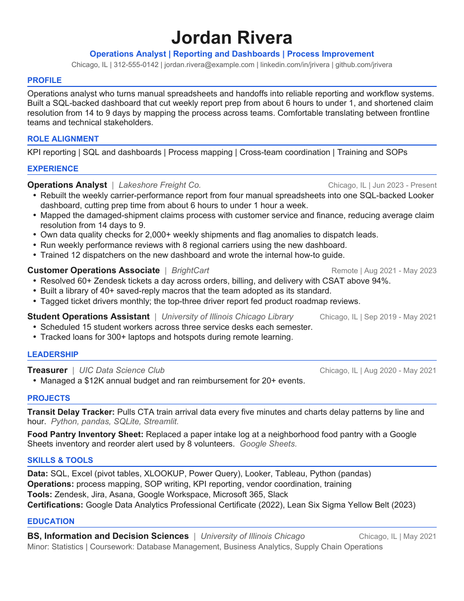

# resume-engine

An evidence-gated, one-page resume builder driven by a coding agent (Claude Code or Codex).

You keep one master `PROFILE.md` with everything true about your career. For each job, the agent writes a small JSON spec that picks and reframes facts for that role, and every line in it has to cite a fact ID. The engine refuses to build if anything cites a fact that doesn't exist, then renders a DOCX and PDF and tunes the spacing until the page is 95-97% full. It won't shrink body text below 10 pt: if the content doesn't fit, it tells you to cut something.

What you get per job:

```
output/2026-10-01-acme-operations-analyst/
  Your Name - OA Resume.docx
  Your Name - OA Resume.pdf
  resume-validation.json
```

The bundled example (a fictional profile, in `example/`) renders like this:



## Setup (once)

System tools (used to render and measure the PDF):

```bash
brew install --cask libreoffice
brew install poppler
```

On Linux, install `libreoffice` and `poppler-utils` with your package manager. If either one lives somewhere unusual, set `SOFFICE=/path/to/soffice`, `PDFTOTEXT=/path/to/pdftotext`, or `PDFINFO=/path/to/pdfinfo`.

Python 3.10+:

```bash
python3 -m venv .venv
.venv/bin/pip install -r requirements.txt
```

Check it works by building the example:

```bash
.venv/bin/python resume.py --data example build base
```

## Start with your own profile

Open this folder in Claude Code (or Codex) and say:

> Set me up. Here's my profile: /path/to/my-profile.md

or

> Set me up from my resume: /path/to/resume.pdf

That runs the `resume-setup` skill. It writes your `data/PROFILE.md`, registers your facts in `data/resume_facts.json`, writes a base spec, builds it, and lists anything it couldn't tell from your source so you can confirm it. It won't make up facts.

`data/` and `output/` are gitignored, so your personal info stays on your machine unless you choose to commit it.

## Tailor to a job

Paste a job description into Claude Code and say "tailor my resume to this" (or `/tailor-resume`). The agent maps the posting's keywords to your facts, lists the ones you have no evidence for (and asks whether any are actually true), writes `data/specs/<company-role>.json`, builds it, and checks the rendered page.

## Running it by hand

```bash
.venv/bin/python resume.py validate <spec>              # evidence check only, no render
.venv/bin/python resume.py build <spec>                 # fit + render + checks
.venv/bin/python resume.py build <spec> --hide-phone    # public copy without phone
.venv/bin/python resume.py --data some/other/dir build base
```

`<spec>` can be a path or just a name in `data/specs/`. Set `RESUME_DATA=/path` to keep your data folder somewhere else (a private notes vault, for example).

## How the data fits together

| File | What it is |
|---|---|
| `data/PROFILE.md` | The only source of truth. Human-readable, any structure, but it needs a `## Contact` block (below). |
| `data/resume_facts.json` | A registry of fact IDs, each with a `source` (`PROFILE.md#Section`) and a short `note`. Specs can only cite these IDs. |
| `data/specs/*.json` | One per target role: headline, summary, which roles and bullets to show, skills, education. Every item cites fact IDs. |

`PROFILE.md` contact block (Name and Email required, the rest optional):

```markdown
## Contact

- Name: Jordan Rivera
- Location: Chicago, IL
- Phone: 312-555-0142
- Email: jordan.rivera@example.com
- LinkedIn: https://www.linkedin.com/in/jrivera/
- GitHub: https://github.com/jrivera
- Website: https://jrivera.dev
```

Optional look-and-feel, in `resume_facts.json` (or per spec):

```json
"style": { "font": "Arial", "accent": "1A56DB" }
```

## Rules the engine enforces

- Every summary, role, bullet, project, skill line, and education entry cites at least one known fact ID.
- No em or en dashes (use plain hyphens). They're a common tell of generated text and some ATS parsers mangle them.
- Exactly one Letter page, 95-97% filled, nothing past the 0.5" margins, body text 10 pt or larger.
- Contact first, then every section heading in the spec's resolved layout order (see [Section layout](#section-layout)).
- A selectable text layer, and in the technical layout, every contact and project link clickable in the PDF.

The rules the agent follows on top of that (real job titles only, no invented numbers or outcomes, a content budget that fits one page) are in `.claude/skills/tailor-resume/SKILL.md`.

## Section layout

By default a resume renders Profile, Role Alignment, Experience, Leadership, Projects, Skills & Tools, Education, and skips any optional section (alignment, leadership, projects, skills) the spec leaves empty. Three optional spec fields change that.

**`section_order`** lists section IDs top to bottom. Built-in IDs: `summary`, `alignment`, `experience`, `leadership`, `projects`, `skills`, `education`. An explicit order must include `experience`, `education`, every custom section, and `skills` if the spec has a nonempty `skills` block. Unknown or duplicate IDs fail validation. You can leave `summary` out, and then the spec doesn't need `summary` or `summary_evidence`. Without `section_order`, custom sections go after skills and before education.

**`section_titles`** renames headings by section ID (built-in or custom). Headings render in uppercase. Unknown keys and blank titles fail validation.

**`sections`** adds custom sections. Each one has:

- `id`: unique slug matching `[a-z0-9_-]+`; it can't reuse a built-in ID
- `title`: the heading
- `type`: one of
  - `bullets`: items are `{text, evidence}`, rendered as bullets
  - `skills-list`: items are `{label, items, evidence}`, rendered like the Skills lines
  - `entries`: items are `{title, organization?, location?, dates?, evidence, bullets?}`, rendered like Experience; each bullet is `{text, evidence}`
- `items`: a nonempty list

Every item and nested bullet must cite at least one known fact ID, the same as the rest of the spec.

These fields can go into `example/specs/base.json` as-is:

```json
{
  "section_order": ["summary", "skills", "experience", "highlights", "volunteering", "projects", "education"],
  "section_titles": {"experience": "Relevant Experience"},
  "sections": [
    {
      "id": "highlights", "title": "Highlights", "type": "bullets",
      "items": [{"text": "Cut weekly report prep from about 6 hours to under 1.", "evidence": ["experience.lakeshore_dashboard"]}]
    },
    {
      "id": "volunteering", "title": "Volunteering", "type": "entries",
      "items": [{
        "title": "Inventory Volunteer", "organization": "Neighborhood Food Pantry", "location": "Chicago, IL",
        "evidence": ["project.food_pantry"],
        "bullets": [{"text": "Built a Google Sheets inventory and reorder alert used by 8 volunteers.", "evidence": ["project.food_pantry"]}]
      }]
    }
  ]
}
```

That order leaves out `alignment` and `leadership`, which is allowed because they're optional. `example/specs/education-first.json` is a complete spec that puts Education and Skills first and has no Profile section.

The build checks the rendered PDF against the resolved headings, so renamed and reordered sections pass the section-order check.

## Technical layout

Set `"layout": "technical"` for a resume that leads with projects: Education, Technical Skills, Selected Technical Projects, Professional Experience, Leadership & Activities. The header is left-aligned with no headline, there is no Profile or Role Alignment section, and email, LinkedIn, GitHub, and website are real hyperlinks. `example/specs/technical.json` is a complete spec.

```bash
.venv/bin/python resume.py --data example build technical
```

Technical specs can also use:

- `projects_note`, with `projects_note_evidence`: a short italic line above the projects
- on each project: `subtitle` (the stack), `description`, `bullets`, and `links` (`[{"label": "Code", "url": "https://..."}]`, https only)
- `**text**` in a bullet to render it bold

`section_order`, `section_titles`, and `sections` work the same way, using the five section IDs above (`education`, `skills`, `projects`, `experience`, `leadership`; `summary` and `alignment` aren't available). Without `section_order`, custom sections go last. The `font` style applies; `accent` doesn't, since this layout uses plain black headings and gray rules. `--reference` is ignored.

The build also checks that every expected link is clickable in the PDF. These results, like the section-order check, are recorded under `checks` and `passed` in `resume-validation.json`; run the artifact test below to enforce them.

### Adding a section type

1. In `resume_factory.py`, write a renderer `(doc, style, section)` that emits the heading with `_section(doc, style, section["title"])` and then the content. Reuse `_bullet`, `_skill_lines`, or `_render_items` where you can.
2. Write a validator `(section)` that checks the items and requires evidence on each one. Raise `ValueError` with paths like `sections[<id>].items[0]`. `_custom_items` and `_validate_item` handle the common cases.
3. Register the pair in `SECTION_TYPES`.
4. If items can hold nested lists of cited things, make sure `_all_evidence_ids` collects them, so unknown IDs are rejected.
5. Add coverage to `tests/test_sections.py`.

## Tests

```bash
.venv/bin/python -m unittest -v tests/test_engine.py tests/test_sections.py tests/test_technical.py
RESUME_ARTIFACT_DIR="output/<dir>" .venv/bin/python -m unittest -v tests/test_engine.py
```

## Files

| File | Role |
|---|---|
| `resume.py` | CLI: `init`, `validate`, `build` (the fit loop) |
| `resume_factory.py` | Evidence validation and DOCX layouts (`classic`, `technical`) |
| `resume_checks.py` | PDF geometry, page count, fill, overflow, section order, links, text layer |
| `example/` | Fictional profile, facts, and specs (`base`, `education-first`, `technical`) |
| `docs/example-resume.png` | Render of the example |
| `.claude/skills/` | `resume-setup` and `tailor-resume` agent workflows |
| `AGENTS.md` | Instructions for any coding agent working in this repo |

## License

MIT
